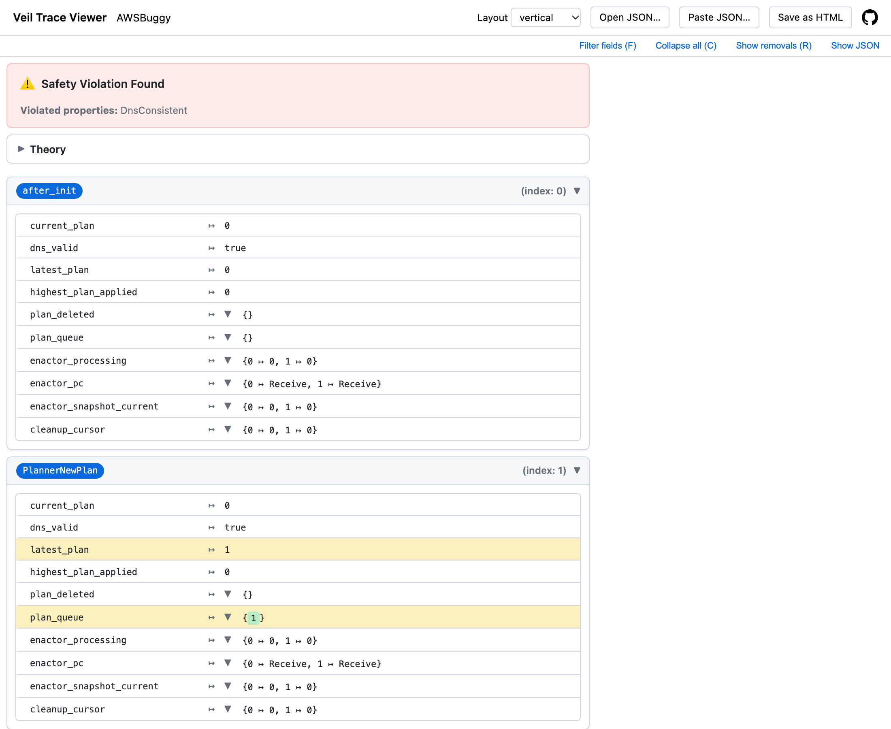

# Veil Trace Viewer

http://s.noguera.dev/veil-trace-viewer/

Shows the result of a [Veil](https://github.com/verse-lab/veil) model check
in a browser, without VS Code.

<small>Generated by Claude Opus 5.5 and Fable 5.2. (61 prompts, 67M tokens, ~$25 API-equivalent cost.) A slightly fancy wrapper for the React component from Veil's VS Code extension (`widget/src/traceDisplay.tsx`) that shows the steps of the model checker output. You can use a gist url for example to share a result using this viewer.</small>

Here is a screenshot, showing [`Examples/AWS/AWSBuggy.lean`](https://github.com/verse-lab/veil/blob/main/Examples/AWS/AWSBuggy.lean) output.



## Use

**In a browser.** Open `index.html`. Drop a result on the page, paste it
(anywhere on the page, or in the box that "Paste JSON…" opens), or use
"Open JSON…". The page reads:

- the JSON that a compiled model checker prints on stdout;
- a result exported from the Veil VS Code extension.

"Save as HTML" writes a copy of the page with the result inside it.

**From a link.** Paste a link instead of JSON, and the page fetches it:

- a gist page, `https://gist.github.com/<user>/<id>` (its first `.json`
  file, or the file that a `#file-…` anchor names);
- a file page on GitHub, `https://github.com/<owner>/<repo>/blob/…`;
- any other `http` or `https` link to the JSON, such as a raw file.

The server of the link must let other sites read the file (CORS); GitHub
does. After a link loads, the address of the page holds it as
`?url=<link>`, so the address can be shared. A page opened with `?url=`
asks before it loads: it shows the link and its server, and fetches
nothing until the person clicks "Load".

**From the command line.**

```sh
./veil-trace.py Model.lean          # build and run each #model_check, write Model.html
./veil-trace.py result.json         # write result.html from a result
./veil-trace.py Model.lean --json   # keep the JSON of the result too
./veil-trace.py Model.lean --open   # open the page in the browser
```

For a `.lean` file, the script finds the Lake project of the file and needs
`lake` on the `PATH`. Each page is one file that needs no server and no
network.

## As a static site

`index.html` is the whole site: one file, with its script and styles inside
it. Any static host can serve it. People open their own result files in the
page. The browser reads each file from the disk of that person; the server
never gets it, and the site keeps no results. A result loaded from a link
comes from the server of the link, not from the site.

A host that forbids inline scripts with its own Content-Security-Policy
header cannot serve the page as it is.

## Security

A result file can come from anywhere, so the page treats it as data only.

- The page shows the values of a result as text. No part of a result becomes
  HTML or script.
- The page has a Content-Security-Policy (a `meta` element in `index.html`):

  | Directive | Effect |
  | --- | --- |
  | `default-src 'none'` | No image, font, frame or worker from any server. |
  | `connect-src https: http:` | `fetch` may reach any server, to load a result from a link. The page fetches only the link that a person pasted, or a `?url=` link after the person clicks "Load". It sends no result anywhere. |
  | `script-src 'sha256-…'` | Only the script of the page runs, by its hash. No other inline script, no script from a URL, no event-handler attribute. |
  | `style-src 'unsafe-inline'` | Inline styles only. Veil's display adds its styles while it runs, so they cannot have a hash. |
  | `base-uri 'none'`, `form-action 'none'` | No change of the base URL, no form submission. |

- The page does not read or write cookies, `localStorage` or other storage.
- A fetch sends no cookies and no referrer.
- "Save as HTML" and `veil-trace.py` keep the policy and the script without
  change, so the hash is correct in the pages that they write.

Limits:

- A `meta` element cannot set the `sandbox` or `frame-ancestors` directives.
  Thus the script of the page itself is not cut off from the cookies of its
  site by the policy; it only does not use them. To make that impossible,
  serve the page from an origin of its own, or let the host send the header
  `Content-Security-Policy: sandbox allow-scripts allow-downloads`. That
  header is not tested here.
- The policy has no effect on what a person does with a file after "Save as
  HTML".
- `connect-src` cannot limit fetches to the links that a person chose; that
  rule is kept by the script of the page, which is the only script that can
  run.

## Build

`index.html` is generated. To build it again:

```sh
git submodule update --init     # once: Veil's sources, in ./veil
npm install                     # once
node build.mjs
```

Veil is a git submodule in `veil/`, at the revision that `index.html` was
built from. The build uses its widget sources (`veil/widget/src`) and the
stub of its VS Code extension (`veil/editors/vscode/webview`), and follows
the build of that extension (`veil/editors/vscode/esbuild.mjs`). For a newer
Veil, check out that revision in `veil/` and build again. `VEIL_DIR` gives
another Veil checkout than the submodule.

The build puts the hash of the script in the policy. Do not edit the script
in `index.html` by hand: the page then stops with an empty window.

- `src/standalone.tsx`: the page around Veil's component (open, save).
- `src/template.html`: the HTML and the colours. Veil's component uses the
  colours of the VS Code theme, so the template gives the values of the
  GitHub Light Default and GitHub Dark Default themes, the second for a
  system in dark mode.

## License

Veil Trace Viewer is licensed under the [Apache License 2.0](LICENSE).

`index.html` bundles Veil's trace display (Apache License 2.0) and React,
React DOM and scheduler (MIT License). The build puts the licence text of
each, with their versions, in a comment at the top of `index.html`, so the
page and every page made from it ("Save as HTML", `veil-trace.py`) carry
them.
